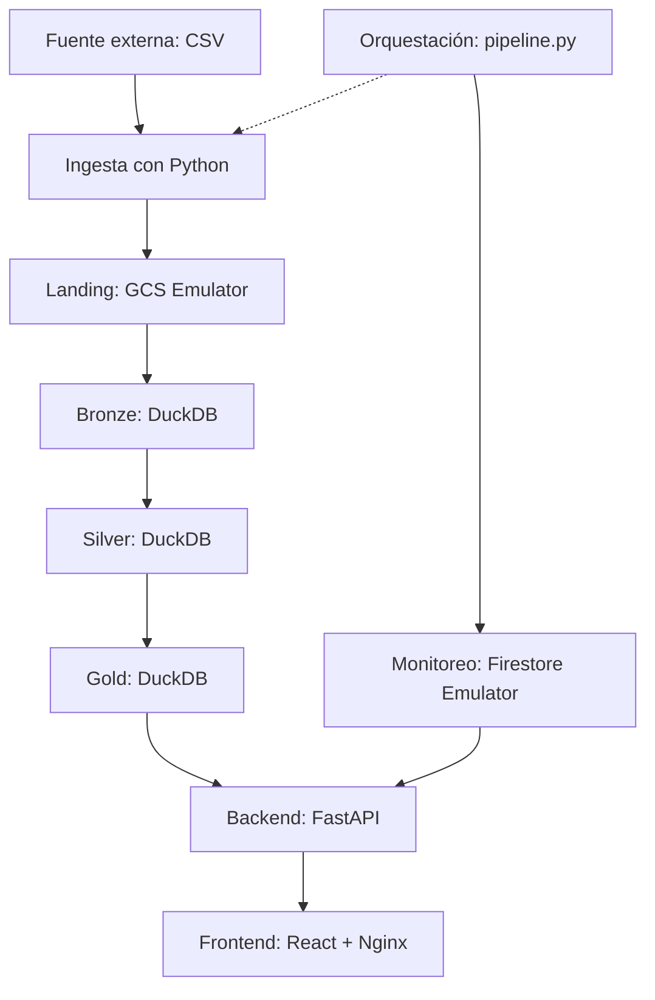

GCP Medallion Data Platform
Plataforma de ingeniería de datos desarrollada con Python, DuckDB,
FastAPI, React y Docker, basada en la arquitectura Medallion.

El proyecto simula un entorno de procesamiento y analítica de datos
inspirado en servicios de Google Cloud Platform (GCP).
1. Objetivo
Implementar un flujo de datos de extremo a extremo que permita:
- Ingerir datos externos en formato CSV.
- Procesarlos mediante las capas Landing, Bronze, Silver y Gold.
- Generar indicadores analíticos de ventas.
- Registrar el historial de ejecución del pipeline.
- Exponer información mediante una API REST.
- Visualizar resultados en un Dashboard React.
- Ejecutar Frontend y Backend utilizando Docker Compose.
2. Arquitectura

3. Tecnologías utilizadas
Componente	Tecnología
Lenguaje de procesamiento	Python 3.12
Almacenamiento Landing	Fake GCS Server
Motor analítico	DuckDB
Transformaciones	Python y SQL
Orquestación	Pipeline Python
Monitoreo	Firestore Emulator
Backend	FastAPI
Frontend	React + TypeScript
Gráficos	Recharts
Compilación Frontend	Vite
Servidor web	Nginx
Contenedores	Docker y Docker Compose
Control de versiones	Git y GitHub

4. Arquitectura Medallion
Landing
Recibe los archivos CSV originales mediante el emulador de
Google Cloud Storage.
Bronze
Almacena los registros de origen y sus metadatos de ingesta.
Silver
Aplica transformaciones, conversiones de tipos,
validaciones y deduplicación.
Gold
Genera tablas analíticas destinadas a consultas y reportes.

Tablas implementadas:
- gold_ventas_resumen
- gold_ventas_tienda
- gold_ventas_producto
- gold_ventas_categoria
5. API REST
El Backend FastAPI proporciona los siguientes endpoints:
Método	Endpoint	Descripción
GET	/health	Estado del Backend
GET	/api/ventas/resumen	Indicadores generales
GET	/api/ventas/tiendas	Ventas por tienda
GET	/api/ventas/productos	Ventas por producto
GET	/api/ventas/categorias	Ventas por categoría
GET	/api/pipeline/ejecuciones	Historial del pipeline

6. Dashboard React
El Dashboard presenta:
- Ventas totales.
- Cantidad de transacciones.
- Número de tiendas y productos.
- Gráfico de ventas por tienda.
- Gráfico de ventas por producto.
- Gráfico circular de ventas por categoría.
- Estado general del pipeline.
- Estado de cada etapa de procesamiento.
- Fechas de inicio y finalización de ejecuciones.
7. Ejecución local con Docker
Requisitos principales:
- Docker Desktop con Docker Compose.
- Python 3.12 para ejecutar el pipeline local.
- Node.js para desarrollo del Frontend.
- Firebase CLI y Java 21 para Firestore Emulator.
Iniciar los servicios Docker
Desde la raíz del repositorio:
docker compose up -d --build
Servicios configurados:
Servicio	Dirección local
Dashboard React + Nginx	http://127.0.0.1:8081
Backend FastAPI	http://127.0.0.1:8001
GCS Emulator	http://127.0.0.1:4444

Iniciar Firestore Emulator
Firestore se ejecuta por separado en Windows:
firebase emulators:start --only firestore --project demo-medallion
Direcciones:
- Firestore: 127.0.0.1:8080
- Firebase Emulator UI: http://127.0.0.1:4000
Para recuperar un respaldo local existente:
firebase emulators:start --only firestore --project demo-medallion --import ./data/firestore-export
El directorio de respaldo no se publica en Git.
Inicio automatizado en Windows (recomendado)
El proyecto incluye scripts de PowerShell para simplificar el inicio
local. Antes de utilizarlos, es necesario tener Docker Desktop en
funcionamiento, Firebase CLI y Java 21 instalados, y un entorno
virtual .venv con las dependencias de requirements.txt.

1. Iniciar Firestore Emulator

En una primera terminal PowerShell, desde la raíz del proyecto:
.\scripts\start-firestore.ps1
Este script recupera un respaldo local si existe e inicia Firestore.
También configura una exportación a data/firestore-export/current
cuando el emulador se detiene normalmente. Mantener abierta esta terminal.

2. Iniciar el pipeline, el Backend y el Frontend

En una segunda terminal PowerShell, desde la raíz del proyecto:
.\scripts\start-project.ps1
Este script verifica Docker Desktop, inicia GCS Emulator, comprueba
la disponibilidad de Firestore, ejecuta las etapas Landing, Bronze,
Silver y Gold, y construye e inicia FastAPI y React con Docker Compose.

3. Acceder a los servicios
- Dashboard: http://127.0.0.1:8081
- Backend: http://127.0.0.1:8001
- Documentación API: http://127.0.0.1:8001/docs
- Firebase Emulator UI: http://127.0.0.1:4000
Los scripts automatizan el inicio local en Windows, pero no instalan
por sí solos Python, Firebase CLI, Java, Docker ni las dependencias
del entorno virtual. No representan un despliegue de producción en GCP.
Datos de prueba
Los datos utilizados actualmente corresponden a un pequeño
dataset de ventas.

En una instalación nueva, el script de ingesta puede crear el bucket
local de GCS si no existe; luego carga los datos de origen y ejecuta el
pipeline para generar las tablas de DuckDB y el historial de Firestore.

La ejecución del pipeline se realiza actualmente desde
Python en el entorno local, no como un servicio automático
de Docker Compose.

Los archivos locales de datos y la base de datos DuckDB
están excluidos del repositorio Git.
8. Resultados del dataset de prueba
Indicador	Resultado
Ventas totales	S/ 83.30
Transacciones	5
Unidades vendidas	16
Tiendas	3
Productos	5
Ticket promedio	S/ 16.66

Estos valores corresponden únicamente al dataset de prueba
utilizado durante el desarrollo.
9. Estado del proyecto
Funcionalidades implementadas:
- Ingesta CSV hacia Landing.
- Procesamiento Bronze, Silver y Gold.
- Generación de indicadores analíticos.
- Registro de ejecuciones en Firestore.
- API REST para consultas analíticas.
- Dashboard React conectado a FastAPI.
- Dockerización de Frontend y Backend.
- Proxy Nginx para solicitudes /api.
10. Próximas mejoras
- Automatizar y programar las ejecuciones del pipeline.
- Incorporar mayor volumen de datos y nuevas fuentes.
- Mejorar el manejo de errores y las pruebas automatizadas.
- Agregar métricas de duración y actualización del monitoreo.
- Optimizar el rendimiento del Frontend.
- Evaluar la migración de componentes a servicios reales de GCP.
11. Alcance
Este proyecto es un laboratorio local de ingeniería de datos
basado en conceptos y servicios de GCP.

Actualmente utiliza emuladores y DuckDB en lugar de una
infraestructura productiva desplegada en Google Cloud.

No utiliza todavía BigQuery, Cloud Run, Dataform administrado
ni una cuenta GCP de producción.